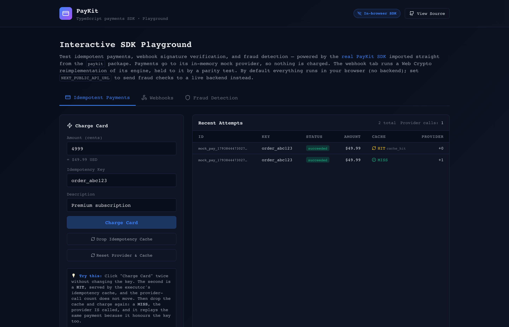

# PayKit

[](#installation)
[](https://www.typescriptlang.org/)
[](LICENSE)
[](https://github.com/ROROK20/PayKit/actions/workflows/ci.yml)
[](CONTRIBUTING.md)

**Open-source TypeScript payments SDK: idempotent payments, fail-closed webhook verification, reconciliation and fraud scoring, with a Stripe adapter and an in-memory mock provider.**

It is built around the correctness primitives behind payments. Each claim comes with the command that checks it:

- **A retried request does not charge twice,** within the window a key is remembered: `ttlMs` in PayKit's store (24 h by default), at least 24 h at Stripe. Past that window the same key can charge again.
  `npx jest tests/idempotent.test.ts -t "double-charge|retries re-send"`
- **Webhook verification fails closed.** A missing secret or signature throws before any handler runs.
  `npx jest tests/webhook.test.ts -t "fails closed"`
- **Reconciliation refuses a false all-clear.** Empty input, a bad record or any disagreement it compares keeps a run from reading `perfect`.
  `npx jest tests/reconciliation.test.ts -t "false all-clear"`

```typescript
import { IdempotentPaymentExecutor, MockProvider } from "paykit";

const executor = new IdempotentPaymentExecutor(new MockProvider({ successRate: 1 }));
const charge = { amount: { amount: 4999, currency: "USD" }, idempotencyKey: "order_123" };

const first = await executor.execute(charge);
const retry = await executor.execute(charge); // same key: the recorded result, no second provider call
console.log(first.id === retry.id); // true
```

**Live demo:** https://paykit-theta.vercel.app (the real SDK running in your browser against a mock provider; no card is ever charged).

**Run it:** `docker compose up --build`, then open http://localhost:3005. No credentials needed.

**What it is not.** The playground runs the real SDK against a mock provider on made-up payments: nothing reaches Stripe and no card is charged. The Stripe adapter has run against the real stripe-node through a scripted HTTP transport ([`tests/stripe_real_sdk.test.ts`](tests/stripe_real_sdk.test.ts)), not against live Stripe. Nothing here is financial advice.

<p align="center">
  
  <br>
  <em>The playground's payments tab: the same idempotency key returns a cache <strong>HIT</strong> and the mock provider is called once, not twice. Captured 2026-11-05 from the production build by <code>npm run capture</code>.</em>
</p>

---

## Why trust it

871 tests across 13 suites (verified 2026-11-04) run with `npm test`, with no network and no credentials. These carry the claims:

- **One charge per key, under races and lost responses.** [`tests/idempotent.test.ts`](tests/idempotent.test.ts): `does not double-charge under CONCURRENT calls with the same key (the race)`, and `a timeout that arrives AFTER the charge: the retry re-sends the same key and gets the same payment, not a second one`.
- **The Stripe adapter is checked against the real stripe-node.** [`tests/stripe_real_sdk.test.ts`](tests/stripe_real_sdk.test.ts) drives stripe-node 22.6.2 through a scripted HTTP transport and checks the request body, headers and error mapping. No socket is opened, so it says nothing about how live Stripe behaves.
- **Webhook verdicts hold in both engines.** [`tests/browser_webhook_parity.test.ts`](tests/browser_webhook_parity.test.ts) asserts each fail-closed, tamper and replay verdict against the Node engine and the playground's browser engine.
- **`perfect` cannot coexist with a disagreement it compares.** [`tests/reconciliation.test.ts`](tests/reconciliation.test.ts): the `a false all-clear is never reported` block, and `seeded fuzz: perfect never coexists with any disagreement the engine claims to compare`.
- **The docs and the package run as written.** [`tests/docs_examples.test.ts`](tests/docs_examples.test.ts) runs the README's fraud and reconciliation examples, compares every printed value, and compiles every TypeScript snippet under strict mode. `npm run build && npm run test:dist` loads the built package as CJS and ESM under plain Node, and `node e2e/smoke.mjs` drives the playground in headless Chromium.

## Known limits

- **Not run against live Stripe.** The adapter was checked against Stripe's API reference and tested against stripe-node. No call has reached Stripe, and what a [Stripe 500](#idempotency) does to a retried key comes from reading stripe-node's source.
- **The at-most-once window ends.** Once PayKit's store and the provider have both forgotten a key, the same key can create a new charge. Anything retried later than that needs your own durable state.
- **The shipped idempotency store is in memory, and webhook deduplication is per process.** With more than one server, you write a shared store (the [Idempotency](#idempotency) section has a Redis example) and make webhook handlers idempotent against your own database.
- **`perfect` is not a full audit.** It says nothing about fees, payouts, disputes or a refund no record states, and a lost dispute still reads as `perfect`. [Reconciliation](#reconciliation) lists exactly what it compares.
- **Non-Stripe webhooks have no replay window,** and there are no Plaid or Wise adapters.
- **Fraud scoring is a small rule engine, not a model.** It reads no IP or device signals, and its amount thresholds are set for 2-decimal currencies.
- **Not on npm, and no third-party security audit.** [Install from source](#installation). [SECURITY.md](SECURITY.md) has the dated dependency audit.

---

## Table of Contents

- [Why trust it](#why-trust-it)
- [Known limits](#known-limits)
- [Features](#features)
- [Installation](#installation)
- [Quick Start](#quick-start)
- [Web Demo / Frontend](#web-demo--frontend)
- [Idempotency](#idempotency)
- [Webhooks](#webhooks)
- [Reconciliation](#reconciliation)
- [Fraud Detection](#fraud-detection)
- [Provider Abstraction](#provider-abstraction)
- [Testing](#testing)
- [Error Handling](#error-handling)
- [Project Structure](#project-structure)
- [Documentation](#documentation)
- [Roadmap](#roadmap)
- [Contributing](#contributing)
- [Security](#security)
- [Code of Conduct](#code-of-conduct)
- [Changelog](#changelog)
- [License](#license)

---

## Features

- **Idempotent payments.** At-most-once charging per idempotency key for as long as the key is remembered (PayKit's store: `ttlMs`, 24 h by default; Stripe: at least 24 h): one provider call in flight per key, recorded results replayed instead of re-executed, conflicting reuse rejected; retries re-send the key, which every provider must honour ([exact guarantee](#what-paykit-guarantees-and-what-it-relies-on-the-provider-for)).
- **Retry with backoff.** Transient failures are retried automatically with exponential backoff.
- **Webhook engine.** Fail-closed HMAC-SHA256 signature verification, replay-window enforcement, bounded in-memory deduplication per process (most recent 10k event IDs; there is no pluggable store, so across instances make handlers idempotent against your own database), and bounded dead-letter tracking.
- **Reconciliation.** Matches internal records against a provider's, and reports each disagreement.
- **Fraud detection.** A pluggable rule engine with built-in velocity, amount and behavioural signals.
- **Provider abstraction.** Swap Stripe for any provider that honours idempotency keys, behind a uniform interface.
- **`MockProvider`.** A full in-memory provider for testing without real API calls.
- **No required runtime dependencies.** Stripe is an optional peer dependency.

---

## Installation

> **Not on npm.** Install from source: clone the repo, or add it as a git dependency,
> and the SDK builds locally. There is no `paykit` package in the npm registry
> (checked 2026-11-04).

```bash
# Install from source
git clone https://github.com/ROROK20/PayKit.git
cd PayKit
npm install     # also builds dist/ (the `prepare` script runs `npm run build`)
```

Or add it directly as a git dependency in another project:

```bash
npm install github:ROROK20/PayKit
```

`dist/` is not committed, so npm builds it during that install: for a git
dependency with a `prepare` script, npm installs the package's dev
dependencies in a temporary checkout, runs `prepare` (`npm run build`), and
installs the result — both `require("paykit")` and `import … from "paykit"`
then work. (Verified 2026-11-02 with npm 10.9.2:
`npm install "git+file://<repo>#<commit>"` into an empty project.) The build
needs the dev toolchain, so the first install takes longer than a registry
install.

```bash
# For Stripe support
npm install stripe
```

Once the first version is published, `npm install paykit` will be the
recommended path — until then, use the from-source instructions above.

---

## Quick Start

```typescript
import {
  StripeProvider,
  IdempotentPaymentExecutor,
  WebhookEngine,
  FraudDetector,
} from "paykit";

// 1. Initialize provider. It loads the optional `stripe` package lazily, in
//    CommonJS and ES-module apps alike; ready() fails fast at boot if it can't
//    (false: no key / stripe not installed; throws: a broken install).
const stripe = new StripeProvider({
  secretKey: process.env.STRIPE_SECRET_KEY,
  // Stripe,  // or pass the SDK yourself: import Stripe from "stripe"
});
if (!(await stripe.ready())) throw new Error("Stripe is not configured");

// 2. Wrap with idempotency
const executor = new IdempotentPaymentExecutor(stripe);

// 3. Create the PaymentIntent — safe to retry
const payment = await executor.execute({
  amount: { amount: 4999, currency: "USD" }, // $49.99
  idempotencyKey: `order_${orderId}`,
  description: "Premium plan",
  metadata: { orderId, userId },
});
// Call again with same key → returns the recorded result, no second intent

console.log(payment.status);  // "pending" — Stripe's requires_payment_method: nothing charged yet
console.log(payment.id);      // "pi_3NxY..."

// 4. Hand payment.clientSecret to Stripe.js in the customer's browser, which
//    collects the card and confirms:
//      stripe.confirmPayment({ elements, clientSecret, confirmParams: { return_url } })
//    The outcome reaches your server as a payment_intent.succeeded webhook
//    (engine.on("payment.succeeded", …) — see Webhooks).
```

### What a Stripe payment returns

`StripeProvider.createPayment` (and so `executor.execute`) sends exactly these
parameters besides `amount`, `currency`, `description`, `metadata` and
`customer`, and returns these statuses. Since Stripe API version 2023-08-16,
automatic payment methods are on by default and confirming requires a
`return_url` unless `off_session=true` or `allow_redirects` is `never`
([changelog](https://docs.stripe.com/changelog/2023-08-16/automatic-payment-methods)).

| You pass | Stripe receives | You get back |
|---|---|---|
| no `paymentMethodId` | `confirm: false`, `automatic_payment_methods: { enabled: true }` | `"pending"` (`requires_payment_method`) and `clientSecret`; confirm in the browser as above |
| `paymentMethodId` (customer present) | `confirm: true`, `payment_method`, `automatic_payment_methods: { enabled: true, allow_redirects: "never" }` — cards and other non-redirect methods only | `"succeeded"`; `"processing"` for methods that settle later; `"pending"` when Stripe answers `requires_action` (3-D Secure) — pass `clientSecret` to `stripe.handleNextAction()` in the browser. A decline throws `ProviderError` (`card_declined`, not retryable) |
| `paymentMethodId` + `returnUrl` | `confirm: true`, `payment_method`, `return_url`, `automatic_payment_methods: { enabled: true }` — redirect-based methods allowed | as above; `requires_action` may now be a redirect, which `stripe.handleNextAction()` performs |
| `paymentMethodId` + `offSession: true` (saved method, customer absent) | `confirm: true`, `payment_method`, `off_session: true`, `automatic_payment_methods: { enabled: true }` | `"succeeded"` or `"processing"`. If the bank demands authentication, Stripe declines with `authentication_required` (`ProviderError`, not retryable): bring the customer back on-session, as below |
| `returnUrl` or `offSession` without `paymentMethodId` | nothing — no API call | throws `PayKitError` `INVALID_REQUEST` |

`captureMethod: "manual"` works with any of these and sends `capture_method`: it
authorizes now and leaves the money to `provider.capturePayment(id)`, and the
result reads `"processing"` (`requires_capture`) until then. Without it there is
nothing to capture.

A saved payment method is attached to a Stripe Customer, and Stripe then
requires that Customer on the PaymentIntent: pass `customerId` with it. The
executor records whatever status comes back — a `"pending"` result is replayed
as `"pending"` for the same key; read the current state with
`provider.getPayment(id)` or from webhooks. Checked against Stripe's API
reference and changelog (2026-11-01; no live call). The adapter is also tested
against the real stripe-node (22.6.2, an exact-pinned devDependency) through a
scripted HTTP transport — request body, headers and error mapping included, no
network (`tests/stripe_real_sdk.test.ts`).

**Bringing an off-session customer back.** The decline's key replays the same
error for at least 24 h, so don't re-send it, and a new key would create a second
PaymentIntent. The declined one still exists, and the error names it, along with
the issuer's reason (Stripe's `payment_intent` and `decline_code`):

```typescript
try {
  await executor.execute(renewal);
} catch (err) {
  if (err instanceof ProviderError && err.code === "authentication_required" && err.paymentIntentId) {
    // err.declineCode: e.g. "authentication_required", "insufficient_funds"
    await orders.setPaymentIntent(orderId, err.paymentIntentId);
    // A link to YOUR page, behind the customer's login. Never the client secret.
    await emailCustomer(`https://shop.example/orders/${orderId}/authenticate`);
  } else {
    throw err;
  }
}

// That page, once it has checked that the signed-in customer owns the order:
const order = await orders.get(orderId);
const intent = await stripe.getPayment(order.paymentIntentId);
// intent.clientSecret goes to this page's Stripe.js, which confirms the payment.
```

The secret is fetched by the page and never leaves it. A client secret in an email
or a URL gets forwarded, logged and left in browser history, and it is what confirms
the payment. The error carries the id and not the client secret for the same
reason: errors get logged and a client secret must not be.

> For a runnable end-to-end script, see
> [`examples/basic_payment.ts`](examples/basic_payment.ts):
> ```bash
> npm run example   # bundles it with the repo's own tsup, then runs it with node
> ```

---

## Web Demo / Frontend

PayKit ships with an interactive **Next.js 15** playground that exercises the
**real SDK** primitives — payments, webhooks and fraud scoring — in the browser, in
memory, with no credentials and no backend to configure. Nothing reaches Stripe and
no card is charged.

```bash
docker compose up --build
# → open http://localhost:3005
```

No Docker? One command without it:

```bash
make demo-local      # builds the SDK, then runs the Next.js playground on :3005
```

The frontend depends on the SDK via a local `file:..` dependency, so the SDK
must be built **first** (this produces `dist/`, which the frontend imports):

```bash
# 1. Build the SDK (from the repo root)
npm install
npm run build

# 2. Run the playground
cd frontend
npm install      # links the local `paykit` package
npm run dev
# open http://localhost:3005
```

Production build:

```bash
cd frontend
npm run build    # succeeds with no backend — falls back to the in-browser SDK
```

The `frontend/lib/sdk.ts` wrapper re-exports the real `MockProvider`,
`IdempotentPaymentExecutor`, `InMemoryIdempotencyStore` and `FraudDetector` from
the `paykit` package, plus a `BrowserWebhookEngine`: its own reimplementation of
the engine over Web Crypto, whose verdicts are parity-tested against the real
Node `WebhookEngine`. The optional
typed backend client lives in `frontend/lib/api.ts` and reads
`NEXT_PUBLIC_API_URL`; on any error the UI falls back to the in-browser SDK.

### Architecture: frontend → real engine

The playground runs the real SDK classes against a mock provider: no request
reaches Stripe, and its payment ids read `mock_pay_…`. The Next.js frontend imports
the actual `paykit` package (wired in as a local `file:..` dependency) and runs its
classes directly in the browser:

```
┌─────────────────────────────┐         imports the REAL package
│  Next.js playground (:3005) │ ─────────────────────────────────────┐
│  frontend/app/page.tsx      │                                       │
└──────────────┬──────────────┘                                       ▼
               │ frontend/lib/sdk.ts          ┌──────────────────────────────────────┐
               │ (thin wrapper)               │  paykit  (this repo, built to dist/)   │
               ├─ MockProvider ───────────────▶  src/providers/mock.ts                 │
               ├─ IdempotentPaymentExecutor ──▶  src/payments/idempotent.ts            │
               ├─ FraudDetector ──────────────▶  src/fraud/detector.ts                 │
               └─ BrowserWebhookEngine ┄┄┄┄┄┄▶  src/webhooks/handler.ts (Node crypto)  │
                  (own dispatch and dedup,     └──────────────────────────────────────┘
                   Web Crypto; parity-tested against the real Node engine)
```

The playground has three tabs: idempotent payments, webhook verification and fraud
scoring. Reconciliation has no tab, and runs from
[its section below](#reconciliation) or `npm run example`.

`MockProvider`, `IdempotentPaymentExecutor` and `FraudDetector` are the literal
shipped code. The webhook engine is not:
it is the only Node-`crypto` part of the SDK, so the browser runs
`BrowserWebhookEngine` (`frontend/lib/sdk.ts`), which reimplements dispatch and
deduplication around the SDK's shared helpers (event-type mapping, event-id rule,
header parsing, replay window) and computes the HMAC with Web Crypto
(`subtle.sign`). Its signatures are **byte-identical** to the real Node engine's
and its verdicts are held to them by a parity test
(`tests/browser_webhook_parity.test.ts`), but it is deliberately less than that
engine: each handler runs once, with no retries, timeout or memory bounds.

**Live vs. demo mode.** By default the playground runs the SDK in-browser
("In-browser SDK" badge). No backend ships in this repository. If you run one
that serves `GET /health` and `POST /fraud/check` (see `frontend/lib/api.ts`),
set `NEXT_PUBLIC_API_URL` to it **at build time** — Next.js inlines
`NEXT_PUBLIC_*` values when it builds, so for Docker that is
`NEXT_PUBLIC_API_URL=… docker compose up --build` (a build argument) — and the
fraud tab tries it first, showing "via live backend", falling back to the
in-browser SDK on any error, so the build and a no-backend static deploy
always work. Only the fraud tab uses it, so the page's badge then reads "Fraud
tab: live backend"; payments and webhooks always run in the browser.

### Deploy

The frontend is Vercel-ready (`frontend/vercel.json`). Because the playground
depends on the SDK being built first (`dist/`), the Vercel build command builds
the SDK, then the frontend.

Set the Vercel project's **Root Directory** to `frontend` (Project → Settings
→ Build & Deployment) and deploy with the Git integration, or run `vercel
deploy` from the **repo root** of a project with that setting. Either way the
whole repository is available to the build, which `frontend/vercel.json` needs:
it builds the SDK in `..` first. (`cd frontend && vercel deploy` uploads only
`frontend/`, so the build stops with a "Wrong Vercel Root Directory" message.)
Verified 2026-11-03 without a Vercel account: the guard in
`frontend/vercel.json` passes when `../package.json` is the SDK and stops,
with that message, when `frontend/` is built on its own; a real deploy has not
been run.

Social previews: set `NEXT_PUBLIC_SITE_URL` (your public origin) at build
time so OG/Twitter images are absolute; on Vercel its production domain is used
when that is unset. A production build with neither omits them rather than
pointing at localhost.

`frontend/vercel.json` already encodes the correct build command
(`build SDK → build Next.js`). No environment variables are required for the
default in-browser demo; set `NEXT_PUBLIC_API_URL` in the Vercel dashboard only
if you want the fraud tab to use a live backend.

---

## Idempotency

The core primitive. Every payment gets a unique key tied to the business event:

```typescript
const executor = new IdempotentPaymentExecutor(provider, {
  retry: {
    maxAttempts: 3,
    initialDelayMs: 200,
    maxDelayMs: 5000,
    backoffFactor: 2,
    // Omit retryableErrors for the default: rate_limit, timeout,
    // network_error, server_error, plus anything the provider flags
    // retryable. A list you pass is EXACT — only those codes are re-sent:
    // retryableErrors: ["rate_limit"],
  },
  ttlMs: 86_400_000, // 24h key TTL; each duration must be finite and above 0
});

// Business-meaningful idempotency keys. A renewal charges the customer's saved
// card while they are away: offSession + the saved method + its Customer.
const renewal = {
  amount: { amount: 9900, currency: "USD" },
  idempotencyKey: `subscription_${userId}_${billingCycleId}`,
  customerId: stripeCustomerId,          // "cus_..."
  paymentMethodId: savedPaymentMethodId, // "pm_..."
  offSession: true,
};
const p = await executor.execute(renewal); // "succeeded" or "processing" — or throws (see above)

// Network timeout? Retry safely:
const same = await executor.execute(renewal); // same key, same request
console.assert(p.id === same.id); // true — only charged once
```

An unusable setting never reaches a payment: `ttlMs`, `failedTtlMs`,
`waitTimeoutMs` and `pollIntervalMs` must each be a finite number above 0 (the
retry delays and `backoffFactor`, finite and not negative), or the constructor
throws `INVALID_CONFIG`. So `ttlMs: Number(process.env.UNSET)` fails at boot.

To avoid charging twice, just call `execute()` again with the key: that is the
guard. `executor.isDuplicate(key)` says only whether a result is **recorded** for
the key, and it is `false` while the first call is still in flight, so checking it
before charging would let a second request through.

Before anything else, `execute()` requires a usable idempotency key — a
non-empty string of printable ASCII (it travels as an HTTP header) without
surrounding whitespace, at most 255 characters (Stripe's limit) — and throws
`INVALID_IDEMPOTENCY_KEY` otherwise. A missing
or blank key is refused rather than defaulted because every key-less request
would share one slot: the second customer would receive the first one's
PaymentIntent, `clientSecret` included. The providers' `createPayment` and
`refundPayment` apply the same rule. Then it validates the money: a positive integer
number of minor units within `Number.MAX_SAFE_INTEGER` and a three-letter
currency code; anything else (`0`, `49.99`, `1e21`, `"usd "`) throws
`INVALID_AMOUNT` / `INVALID_CURRENCY` without reaching the provider.

### What PayKit guarantees, and what it relies on the provider for

For one idempotency key, across every executor sharing an `IdempotencyStore`, a
provider name and a `scope`, PayKit guarantees:

- **One provider call in flight at a time.** The store's atomic `reserve`
  admits a single winner; concurrent callers wait for its result instead of
  calling the provider.
- **No new provider call once a result is recorded.** A result in which money
  may have moved — `succeeded`, or still `pending` / `processing` — is
  replayed for `ttlMs` (24h by default); one in which no money moved
  (`failed`, `cancelled`) for `failedTtlMs` (60s). A replay is the result as
  first recorded, with one change:
  `metadata._idempotency` is set to `cache_hit` or `in_flight_join`, replacing
  any value of your own under that key. Read a pending payment's current status
  with `provider.getPayment(id)` or from webhooks.
- **Conflicting reuse is rejected** (below).
- **Every caller gets its own copy.** The store keeps a deep copy of the
  result and each caller — the first included — receives another, so
  mutating a result (`delete p.clientSecret`, `p.status = "failed"`) can never
  change what later duplicates of the key see.
- **A duplicate that cannot wait gets a clear answer.** A concurrent caller
  waits up to `waitTimeoutMs` (10 s by default) for the in-flight result —
  less than a Stripe call can take (~122 s worst case with the adapter's
  defaults), so it may answer first with `PayKitError`
  `IDEMPOTENCY_WAIT_TIMEOUT` (`retryable: true`): still in flight, nothing
  charged twice; re-send the same key later for the result.
- **A store failure never hides why a payment failed.** If the provider's call
  fails and the store then cannot release the reservation either, you get the
  provider's error, with what `release()` threw on its `releaseError`. The key
  stays reserved until the store's marker expires, and until then the same key
  answers `IDEMPOTENCY_WAIT_TIMEOUT` rather than reaching the provider.
- **A store failure after the provider answered is not reported as a failed
  payment.** If `store.set` throws, `execute()` throws
  `PaymentResultNotStoredError` (`PAYMENT_RESULT_NOT_STORED`, not retryable)
  carrying the provider's result in `err.intent`, and the cause in `err.cause`.
  The money may have moved, so never answer "please try again". The reservation
  is kept, so a retry under the same key waits rather than reaching the provider
  while the store is down; no second charge is possible through PayKit. Persist
  `err.paymentIntentId` yourself. The client secret stays out of logs: `err.intent`
  is not an own property of the error, so `JSON.stringify(err)` and
  `console.log(err)` don't reach it, while reading `err.intent.clientSecret` by name
  still works, as `examples/nextjs_integration.ts` does. Don't log `err.intent`
  itself. `err.cause` is whatever your store threw, so if its errors quote the value
  being written, keep `cause` out of your logs too.

PayKit relies on the provider for one thing: **deduplicating a re-sent
`createPayment` with the same key.** The executor re-sends it when an attempt
fails with a retryable error (`timeout`, `network_error`, `server_error`,
`rate_limit`, or any error marked `retryable`; an explicit
`retry.retryableErrors` list replaces that set exactly) — and a timeout can arrive after
the provider charged the card, which no client can detect — when an earlier
hard failure released the key, and when a recorded result has expired or been
evicted from the store. So `PaymentProvider_Interface` makes it a requirement:
the same key and request again must return the original payment, and the same
key with a different request must throw `IdempotencyError`, for at least
`ttlMs`. `StripeProvider` forwards the key as Stripe's `Idempotency-Key`
(Stripe replays the first response for a key, errors included, for at least
24h); `MockProvider` deduplicates the same way in memory. Together that is
at-most-once charging per key — **within the window in which the key is
remembered**: PayKit's store keeps a result for `ttlMs` (24 h by default) and
Stripe keeps a key for at least 24 h. Once both have forgotten it, the same
key can create a new charge, so anything that may be retried later than that
(a nightly job, a support action days on) must be guarded by your own durable
state — an order marked paid, a refund marked done — as
`examples/nextjs_integration.ts` does. No client-side layer can make a provider
without idempotency keys at-most-once; its adapter must deduplicate itself
(see [Provider Abstraction](#provider-abstraction)).

**A key still in flight at Stripe is retried, not reported as a conflict.**
When a client-side timeout fires while Stripe is still executing the first
attempt, the executor's re-send gets Stripe's `idempotency_key_in_use`; the
adapter maps it to a retryable `ProviderError`, so a later attempt collects
the original result under the same key.

**A Stripe 500 leaves the outcome unknown, and the same key may never settle it.**
`StripeAPIError` maps to `server_error`, which is `retryable` and carries
`outcomeUnknown: true`. The executor still re-sends it under the same key, because
that cannot charge twice and can clear a 503 or a lock timeout. A 500 is different:
a comment in stripe-node's own source (`cjs/RequestSender.js`, in its retry decision)
says Stripe's idempotency framework "would typically replay" a 500, so expect the
key to keep answering 500 and the retries to end with this same error. This comes
from reading stripe-node's source and has not been observed against live Stripe.
When `server_error` reaches you:

1. **Retrying the same key can't resolve it, and a new key can double-charge.** If
   the request named a `paymentMethodId`, the adapter sent `confirm=true`, so a first
   attempt that did go through plus a new key is two charges.
2. **Record the payment as unknown** on your order, and don't tell the customer it
   failed.
3. **Reconcile against the provider before any new key.** Look for the PaymentIntent
   by something you sent, such as `metadata.order_id`: in the Dashboard, or with
   `paymentIntents.search` on your own Stripe client, and watch for its
   `payment_intent.*` webhooks. stripe-node's documentation of search warns it can lag
   by up to an hour during outages (and that search is not available to merchants in
   India), so an empty result straight away proves nothing.
4. **Found it? That is the payment:** keep its id and read it with
   `provider.getPayment(id)`. Use a new key only once you have established that no
   payment exists.

`outcomeUnknown` is also `true` on `timeout`, `network_error` and
`idempotency_key_in_use`, where re-sending the same key does collect the original
result, so re-send. An `unknown` error carries it too, and is not retried: treat it
like the 500.

**Retrying a declined card takes a new key.** Stripe raises a decline as an
error (a non-retryable `ProviderError`, e.g. code `card_declined`). Errors are
never cached — the reservation is released — but Stripe replays that decline
for the same key for at least 24h. An off-session `authentication_required` is
different: the customer can finish the same PaymentIntent, named by
`err.paymentIntentId` (see [What a Stripe payment returns](#what-a-stripe-payment-returns)).

**Conflicting reuse is rejected, on every server.** Reusing a key with a
different request — any field: amount, currency, description, metadata,
customer, payment method, return URL, `offSession`, `captureMethod` — throws `IdempotencyError`. The request
fingerprint is stored *with* the cached result in the `IdempotencyStore`, so a
second server sharing the store detects the conflict too instead of quietly
returning the first request's charge.

**One store, several accounts: set a `scope`.** Results are stored per provider
name and `scope`, because a provider's keys are unique only within its own
account. Two `StripeProvider`s, for test and live or for two merchants, are both
named `stripe`, so without a scope the second executor is handed the first's
result, client secret included, and its own provider is never called:

```typescript
const test = new IdempotentPaymentExecutor(new StripeProvider({ secretKey: process.env.STRIPE_TEST_KEY }), { store, scope: "test" });
const live = new IdempotentPaymentExecutor(new StripeProvider({ secretKey: process.env.STRIPE_LIVE_KEY }), { store, scope: "live" });
```

Use a merchant id the same way. Your servers for one account take the same scope,
or none, since sharing is the point there. The provider still receives your key
unchanged, and `isDuplicate` and `invalidate` act within the scope. PayKit cannot
tell two accounts apart by itself, so it cannot warn you when a scope is missing.
If you read a store directly, its keys are `idempotencyStoreKey(providerName, scope,
key)`.

**Production note:** Replace `InMemoryIdempotencyStore` with Redis. The store
interface has **six** methods, not four: `reserve` and `release` are what make
the one-call-in-flight guarantee hold across processes, so a store without them does
not compile — and a hand-rolled check-then-set version reopens the double-charge
race this whole component exists to close. `get`/`set` move an
`IdempotencyRecord` (`{ intent, fingerprint }`): persist all of it. A cached
Stripe intent includes its `clientSecret`, so give the store the same access
controls as any other payment credential.

```typescript
import { randomUUID } from "node:crypto";
import { IdempotencyRecord, IdempotencyStore } from "paykit";

// Prefix of every in-flight marker; the rest of the marker is that
// reservation's own token. A marker is never a terminal result.
const PENDING = "__paykit_pending__:";
// Delete KEYS[1] only while its value is ARGV[1] — release() with a token...
const DEL_IF_EQUAL =
  'if redis.call("get", KEYS[1]) == ARGV[1] then return redis.call("del", KEYS[1]) else return 0 end';
// ...or only while it is NOT a pending marker — delete() drops results only.
const DEL_IF_NOT_PENDING =
  'local v = redis.call("get", KEYS[1]) if v and string.sub(v, 1, #ARGV[1]) ~= ARGV[1] then return redis.call("del", KEYS[1]) end return 0';

class RedisIdempotencyStore implements IdempotencyStore {
  constructor(private redis: Redis, private pendingTtlMs = 180_000) {}

  async get(key: string): Promise<IdempotencyRecord | null> {
    const raw = await this.redis.get(key);
    if (!raw || raw.startsWith(PENDING)) return null; // in flight, not done
    const record = JSON.parse(raw) as IdempotencyRecord;
    // JSON turns Dates into ISO strings; revive the two the SDK types as Date.
    record.intent.createdAt = new Date(record.intent.createdAt);
    record.intent.updatedAt = new Date(record.intent.updatedAt);
    return record;
  }

  /** The result AND its request fingerprint, so every server can check reuse. */
  async set(key: string, record: IdempotencyRecord, ttlMs = 86_400_000): Promise<void> {
    await this.redis.set(key, JSON.stringify(record), "PX", ttlMs); // replaces the marker
  }

  /** Drops a terminal result — never an in-flight reservation (the store contract). */
  async delete(key: string): Promise<void> {
    await this.redis.eval(DEL_IF_NOT_PENDING, 1, key, PENDING);
  }
  async has(key: string): Promise<boolean> { return (await this.get(key)) !== null; }

  /**
   * ONE atomic command. `NX` makes the write land only if the key is absent, so
   * exactly one concurrent caller can ever win — that IS the double-charge
   * defense. Never write this as `exists()` then `set()`: between those two
   * round-trips a second request also sees "absent", and both callers charge.
   * The marker is a fresh token, returned to the executor for release().
   */
  async reserve(key: string): Promise<string | null> {
    const token = `${PENDING}${randomUUID()}`;
    const won = await this.redis.set(key, token, "PX", this.pendingTtlMs, "NX");
    return won === "OK" ? token : null; // null when the key already existed
  }

  /** Compare-and-delete against THIS reservation's token, never someone else's. */
  async release(key: string, token: string): Promise<void> {
    await this.redis.eval(DEL_IF_EQUAL, 1, key, token);
  }
}

const executor = new IdempotentPaymentExecutor(provider, {
  store: new RedisIdempotencyStore(redis),
});
```

Size `pendingTtlMs` above the whole **retry envelope**, not one provider call —
`execute()` retries internally, so one reservation can span every attempt, and
stripe-node retries inside each attempt:
≈ `maxAttempts × ((1 + maxNetworkRetries) × timeoutMs + SDK retry sleeps)` plus
the executor's backoff. With the shipped defaults — `StripeProvider`
`timeoutMs` 20 s and `maxNetworkRetries` 1 (stripe-node's own defaults are 80 s
and, in current versions, 2 retries — which is why PayKit sets both), a 0.5 s
sleep before stripe-node's retry, executor `maxAttempts` 3 and at most ~600 ms
of backoff — that is 3 × (2 × 20 s + 0.5 s) + 0.6 s ≈ 122 s, which the 180 s
default above clears. Change any of those and recompute. The TTL only exists so
a crashed process cannot pin a key forever, and if it expires while a charge is
still in flight another caller can win a fresh reservation for that key. That is why each marker is its
reservation's own **token**: `reserve()` returns it and the executor passes it
to `release()`, which deletes the marker only while it still holds that token —
so the first caller's late release cannot delete the second caller's
reservation and let a third one charge. The command syntax above is `ioredis`;
on `node-redis` v4 the same call is `set(key, token, { PX: pendingTtlMs, NX: true })`.

---

## Webhooks

Handlers register PayKit's provider-neutral event names. For Stripe, the
engine maps the event type Stripe sends to that name, keeps Stripe's original
in `event.providerType`, and also runs handlers registered under the raw Stripe
name — each handler at most once per event:

| Stripe sends | PayKit `event.type` |
|---|---|
| `payment_intent.succeeded` | `payment.succeeded` |
| `payment_intent.payment_failed` | `payment.failed` |
| `payment_intent.processing` | `payment.processing` |
| `payment_intent.canceled` | `payment.cancelled` |
| `charge.dispute.created` / `charge.dispute.updated` | `dispute.created` / `dispute.updated` |
| `charge.dispute.closed` (status `won` / `lost`) | `dispute.won` / `dispute.lost` |
| anything else (`refund.created`, `charge.refunded`, …) | unchanged |

`refund.succeeded` compiles, for a provider that sends it, but it never fires for
Stripe: Stripe has no such event and PayKit does not derive one. For a Stripe
refund's outcome, listen to `refund.updated`, `refund.failed` or `charge.refunded`.

```typescript
const engine = new WebhookEngine({ maxRetries: 3 });

// `data` is the provider's payload, `unknown` until you say what you read from it.
// That is a compile-time claim, not a runtime check. Stripe's own type fits too:
// `{ object: Stripe.PaymentIntent }`.
type PaymentData = { object: { id: string; customer: string; metadata: Record<string, string> } };

// Register typed handlers
engine.on<PaymentData>("payment.succeeded", async (event, data) => {
  await fulfillOrder(data.object.id);
  await sendConfirmationEmail(data.object.metadata.userId);
});

engine.on<PaymentData>("payment.failed", async (event, data) => {
  await notifyCustomer(data.object.customer, "payment_failed");
});

engine.on(["dispute.created", "dispute.updated"], async (event, data) => {
  await escalateToSupport(data);
});

// In your route handler (Next.js, Express, etc.)
// IMPORTANT: use raw body for signature verification
app.post("/webhooks/stripe", express.raw({ type: "application/json" }), async (req, res) => {
  try {
    const result = await engine.process({
      rawBody: req.body.toString(),
      signature: req.headers["stripe-signature"] as string,
      secret: process.env.STRIPE_WEBHOOK_SECRET!,
      provider: "stripe",
    });
    // No handler matched. It is still acknowledged (providers send types you
    // may not handle), but a handler under the wrong name looks the same: log it.
    if (result.unhandled) logger.warn(`No webhook handler for ${result.eventType}`);
    if (result.processed || result.error === "duplicate_event") {
      res.json({ received: true }); // done, or already done: stop redelivering
    } else {
      // "handler_failed": a handler exhausted its retries (see dead letters).
      // "in_flight": another delivery of this event is still running.
      // Either way, any non-2xx makes the provider redeliver later instead of
      // marking the event delivered — fulfilment is retried, never dropped.
      res.status(503).json({ received: false, error: result.error });
    }
  } catch (err) {
    if (err instanceof WebhookSignatureError) {
      res.status(400).send("Invalid signature");
    } else {
      res.status(500).send("Webhook error");
    }
  }
});

// Monitor dead-letters (events where all retries failed). In memory and
// bounded: the most recent 1,000 by default (`maxDeadLetters`; 0 = unbounded).
const failed = engine.getDeadLetters();
```

**A misspelt event name does not compile, and an unmatched event says so.**
`on()` takes a known name (PayKit's canonical names, the Stripe names behind
them, and Stripe's refund events), `*`, or `customEvent(name)` for anything else:

```typescript
// @ts-expect-error -- no such event, so this line does not compile
engine.on("payment_intent.suceeded", handler);
engine.on(customEvent("invoice.paid"), handler);        // any other event, spelt by you
```

A plain `string` variable needs `customEvent()` too. At runtime a name that
matches nothing is not an error: the delivery returns `processed: true`,
`handlersRun: 0` and `unhandled: true`. Answer it 2xx, since providers send types
you may not handle and a non-2xx would have them retry for days, but log it,
because the provider then stops retrying and the event is gone. To make an
unmatched event always a bug, subscribe your Stripe endpoint only to the events
you handle and alert on `unhandled`.

`engine.on("*", handler)` runs for every event, and so it counts as a match: with
one registered, nothing is ever `unhandled`. To audit every event and still see
the unmatched ones, record them in the route instead of in a wildcard:

```typescript
const result = await engine.process({
  rawBody: req.body.toString(),
  signature: req.headers["stripe-signature"] as string,
  secret: process.env.STRIPE_WEBHOOK_SECRET!,
  provider: "stripe",
});
await auditLog.record(result.eventType, result.eventId);
if (result.unhandled) logger.warn(`No webhook handler for ${result.eventType}`);
```

**A slow handler never runs twice at once.** `process()` waits for a handler
attempt up to `handlerTimeoutMs` (default 30,000; 0 = no limit). Past that it
returns `in_flight` (answer non-2xx; the provider redelivers) and aborts the
attempt's `signal` — the handler's third argument, `{ signal }`, which you can
pass to `fetch` — but it does not abandon the attempt: the event stays
reserved in this process until the attempt settles, so redeliveries meanwhile
also get `in_flight` and no second copy starts. Its real outcome is then
recorded: a late success marks the event processed (the next redelivery is
acknowledged as `duplicate_event`); a failure is retried — only after it
settled — and dead-lettered as usual. A handler that ignores its signal and
never settles keeps its event `in_flight` in that process until it does or
the process restarts. All of this is per process: across instances, keep
handlers idempotent.

**`handlerTimeoutMs` bounds one attempt, not the whole response.** Each attempt
gets its own timer, so a handler that keeps failing just under the limit never
turns into `in_flight`: `process()` waits through all `maxRetries` attempts and
the backoff between them, and handlers run one after another. At the defaults
(3 attempts, 30 s each) that can hold the HTTP response for about 90 s per
handler. If your provider gives up on a delivery sooner than that, lower
`handlerTimeoutMs` or `maxRetries`, or have handlers hand slow work to a queue.

**A failed event is never acknowledged.** If any handler exhausts its retries,
`process()` returns `{ processed: false, error: "handler_failed" }`, the event
is dead-lettered, and its id is **not** remembered — so the provider's
redelivery runs the handlers again instead of being swallowed as a duplicate.
That makes delivery at-least-once: handlers that succeeded the first time run
again on the redelivery, so write them to be idempotent (e.g. key fulfilment
on the PaymentIntent id).

**Non-Stripe senders: generic HMAC, no replay window.** For any provider
other than `"stripe"`, `process()` checks a plain `sha256=<hex>` HMAC-SHA256
of the raw body (the GitHub-style scheme). Two limits, stated plainly:

- **No timestamp is signed, so there is no replay window.** A captured,
  validly-signed request verifies again tomorrow; the only defence is event-id
  deduplication, which is in-memory and bounded (`maxProcessedIds`). Put a
  timestamp check in front of it, or prefer a timestamped scheme, if replay
  matters to you.
- **It is not Plaid's or Wise's scheme.** Plaid signs webhooks with a JWT
  (ES256, `Plaid-Verification` header) and Wise with RSA
  (`X-Signature-SHA256`); neither is implemented, so their real webhooks fail
  verification — closed, never open.

**Duplicate and concurrent deliveries dispatch once.** The event — keyed by
provider *and* id, since ids are unique only within one provider — is
reserved synchronously before any handler runs, so two overlapping deliveries
of one event (a provider retry racing a slow first attempt) cannot both run
your handlers: the loser gets `error: "in_flight"`, which the route above
answers 503 so the provider retries later. This holds within one process: the
engine keeps its dedup state in memory and has no pluggable store. With several
instances behind a load balancer (or across restarts), enforce exactly-once
effects in your handlers against your own database — e.g. insert
`webhookDedupKey(provider, id)` under a unique constraint and skip the work
when it already exists. A different provider's event with the same id is a
different event: it never suppresses this one.

**An event without an id is rejected, not processed.** Dedup keys on the
provider plus the event's `id` (for non-Stripe providers, `id` or `eventId`;
a number is used as its decimal string). A verified payload without one throws
`PayKitError` (`code: "INVALID_PAYLOAD"`) before any handler runs — inventing
an id would make every redelivery look new and run the handlers again. A
verified body that is valid JSON but not an object (`null`, an array, a
number) throws `PayKitError` `INVALID_PAYLOAD` ("Webhook body must be a JSON
object") the same way.

**Stripe header handling.** The `Stripe-Signature` header may carry several
`v1=` signatures — Stripe sends one per active secret while you roll an
endpoint secret — and a match against any of them is accepted. Each must be
exactly 64 lowercase hex characters; anything else (trailing junk, a
truncated or over-long digest) is a mismatch.

**The replay window is validated, not assumed.** Stripe signatures older (or
newer) than `toleranceSeconds` — default 300 — are rejected. The option must
be a finite number from 0 to 86,400 (0 turns the check off, explicitly);
anything else throws `INVALID_CONFIG` at construction. `NaN` is the one to
watch: `toleranceSeconds: Number(process.env.WEBHOOK_TOLERANCE)` with the
variable unset would otherwise accept signatures of any age. The other numeric
options are validated the same way (`maxRetries` is an integer >= 1).

**Verification fails closed.** If `secret` is passed, a missing or empty
signature header is rejected (`WebhookSignatureError`, `reason:
"missing_signature"`) before any handler runs. If `secret` is missing or empty —
say `STRIPE_WEBHOOK_SECRET` is unset in one environment — `process()` also
throws (`reason: "missing_secret"`; treat that one as a misconfigured server
and alert on it) instead of quietly skipping verification. The only way to
process unsigned events is to opt in when constructing the engine,
`new WebhookEngine({ allowUnsigned: true })`, meant for local demos and tests;
it never relaxes a secret you did pass.

---

## Reconciliation

```typescript
import { ReconciliationEngine, InternalRecord, ProviderRecord } from "paykit";

// Your database's records for a period, and the provider's for the same period
// — here Stripe PaymentIntents, whose ids are what your records store as
// providerPaymentId and whose status is a payment outcome. (Balance
// transactions: see the note below.) Inline here; load them in practice.
const day = new Date("2026-11-02T12:00:00Z");
const internal: InternalRecord[] = [
  { id: "i_abc", providerPaymentId: "pi_xyz", amount: { amount: 5000, currency: "USD" }, status: "succeeded", createdAt: day },
  { id: "i_def", providerPaymentId: "pi_uvw", amount: { amount: 2500, currency: "USD" }, status: "succeeded", createdAt: day },
  { id: "i_ghi", providerPaymentId: "pi_rst", amount: { amount: 1200, currency: "USD" }, status: "succeeded", createdAt: day },
];
const provider: ProviderRecord[] = [
  { id: "pi_xyz", amount: { amount: 4999, currency: "usd" }, status: "succeeded", createdAt: day },
  { id: "pi_uvw", amount: { amount: 2500, currency: "usd" }, status: "failed", createdAt: day },
  { id: "pi_rst", amount: { amount: 1200, currency: "usd" }, status: "succeeded", createdAt: day },
  { id: "pi_phantom", amount: { amount: 900, currency: "usd" }, status: "succeeded", createdAt: day },
];

const report = new ReconciliationEngine({ provider: "stripe" }).reconcile(internal, provider);

console.log(report.summary); // "Matched 1/3. 1 provider record unmatched. 1 amount mismatch. 1 status mismatch. Review required."
console.log(report.outcome); // "review_required" — only "perfect" is an all-clear

// Investigate issues
const issues = report.matches.filter((m) => m.status !== "matched");
console.log(issues.map((m) => m.status)); // ["amount_mismatch","status_mismatch","unmatched_provider"]
console.log(issues[0].notes);             // "Amount mismatch: internal=5000 provider=4999."
console.log(issues[1].notes);             // "Status mismatch: internal=succeeded provider=failed."
console.log(issues[2].providerId);        // "pi_phantom"
```

What counts as a match, precisely:

- **Unusable records are reported, never matched.** Before any matching,
  every record on both sides is checked: a non-empty string `id`, an amount
  that is a safe integer of minor units (negative and zero are allowed —
  refund rows), a three-letter currency, a string `status`, a valid `Date`
  `createdAt`. Anything else — an amount of `NaN`, `undefined`, `Infinity` or
  `49.99`, a `new Date("garbage")` — gets status `invalid` with the reason in `notes`, is counted in
  `report.invalid`, and keeps the summary from ever reading "Perfect". (A
  `NaN` amount would otherwise compare equal to everything and reconcile as a
  clean match.)
- **Amounts match exactly by default.** Amounts are integer minor units, so the
  default `toleranceAmount` is `0`: a 1-cent shortfall is an `amount_mismatch`,
  as in the example above. Opt in to a tolerance
  (`new ReconciliationEngine({ provider: "stripe", toleranceAmount: 1 })`) only
  if your ledger and the provider genuinely round differently — it hides every
  real discrepancy up to that size. It must be a non-negative integer.
- **Amount, currency and outcome must all agree.** Currency codes compare
  case-insensitively — Stripe's API returns `usd`, PayKit intents carry `USD`
  — so raw provider rows reconcile without pre-processing. Statuses agree only
  if they share a row of this table (case-insensitive); a status in no row must
  match verbatim. Any other pair is a `status_mismatch`, which keeps the run from
  reading "Perfect".

  | Outcome | Statuses |
  |---|---|
  | succeeded | `succeeded`, `paid`, `available` |
  | refunded | `refunded` |
  | partially refunded | `partially_refunded` |
  | failed | `failed`, `cancelled`, `canceled` |
  | money in flight or on hold | `processing`, `in_transit`, `requires_capture` |
  | nothing taken yet | `requires_payment_method`, `requires_confirmation`, `requires_action`, and a ledger's `pending` |

  So `pending` against `succeeded` is a mismatch in either direction: it may
  settle by the next run, but today the two sides disagree on whether the money
  moved. The last two rows disagree for the same reason. Stripe returns a
  PaymentIntent to `requires_payment_method` when a debit fails, so a ledger's
  `processing` against it is a failed debit the ledger has not heard of. A
  provider row's bare `pending` agrees with either row, because it does not say
  which: a Stripe Charge says `pending` of a debit in flight, and `StripeProvider`
  folds the `requires_*` statuses into `pending`. Reconcile Stripe's raw status,
  since a failed debit is invisible in the mapped one.
- **A refund is not a kind of success, and a total is what proves one.** A ledger
  `refunded` against a provider `succeeded` is a `status_mismatch`, and so is the
  reverse. A Stripe PaymentIntent or Charge stays `status: "succeeded"` after a
  refund, so that status cannot show that one happened. Give each record
  `amountRefunded`, in minor units (on the provider side, a Charge's
  `amount_refunded`), and keep Stripe's raw status: a `succeeded` row stating a
  total above 0 reads as partially or fully refunded, so it reconciles cleanly
  against a ledger's `partially_refunded` or `refunded`.

  The totals themselves are compared, within `toleranceAmount`. Ledger $10 against
  Stripe $40 is a `refund_mismatch`, with the gap in `amountDiscrepancy`, and it is
  how a refund issued twice shows up. A `partially_refunded` pair where either side
  states no total is `refund_unverified`, because agreeing that some money went
  back says nothing about how much. A `refunded` status with no total implies the
  whole amount; any other row with no total claims no refund. A total that is not
  a safe integer from 0 to the size of the amount, or that contradicts the record's
  own `refunded` or `partially_refunded` status, makes the record `invalid`.
- **A `reference` on both sides must be the same one.** Both sides carrying one,
  and different, is a `reference_mismatch`: the charge is paired, but it may be
  paying for another order. They compare exactly, and only once a pair is made;
  `reference` never decides which records pair. With one on one side only there
  is nothing to compare.
- **`status` is read as a payment outcome — unless you say otherwise.** By
  default a provider `pending` means *not paid yet* (PaymentIntent / Charge
  vocabulary). Stripe **balance transactions** use `pending` for *charged, funds
  not yet available* — normal for about two days after every charge — so
  reconciling them as payments would flag each recent charge as a
  `status_mismatch`. Pass `providerRecordType: "balance_transaction"` and both
  `pending` and `available` count as succeeded. Use charge-type balance
  transactions (refunds and fees reconcile separately), and set each record's
  `id` to what your internal records store as `providerPaymentId` — for a
  charge, its `payment_intent` (list with `expand: ["data.source"]`) — or
  leave internal ids empty, set `fuzzyDate: true`, and let fuzzy matching pair
  them (without it, only identical timestamps pair).
- **One provider charge, one claimant.** If two internal records carry the
  same `providerPaymentId`, the first is matched and the second is reported
  `duplicate`. Likewise, if the provider records contain one id twice, the
  first is reconciled and each later one gets its own `duplicate` entry naming
  both amounts — a second charge can never hide under the first's id. The
  same holds for your side: an internal id recorded twice is a `duplicate`
  entry, kept out of matching, so the charge it pointed at shows up as
  unmatched instead of the run reading "Perfect".
- **Possible double-submits, only where identity is unknown.** An internal
  record with no `providerPaymentId` that shares amount, currency and UTC
  calendar day with another internal record is flagged `duplicate: true` (a
  clean match becomes status `duplicate`). A record naming its own provider
  charge is never flagged by this heuristic — two customers buying the same
  plan on the same day are two matches. Days are UTC, so the verdict does not
  depend on the server's time zone.
- **A named charge is never swapped for another.** A `providerPaymentId` the
  provider does not have is `unmatched_internal`; only records with no
  provider id are fuzzy-matched by amount and date (±1 day with
  `fuzzyDate: true`, identical timestamps otherwise).
- **Fuzzy matching is a best assignment, not first-fit.** Among all pairings
  of eligible records it picks one with the most pairs, then the smallest total
  time distance, and the input order never changes the result: internal A at
  0 h and B at +40 h against charges at +20 h and −20 h pair A with −20 h and B
  with +20 h, where first-fit would have stranded one of each. It is solved
  exactly per group of records that could pair with each other — O(k²·l) for a
  k × l group, which is milliseconds normally and seconds for a thousand
  id-less records of one amount on one day.
- **Two charges under one `reference` are a possible double charge.** One order
  paid on two PaymentIntents reconciles cleanly charge by charge, so give each
  record a `reference` (your order or invoice id), on `InternalRecord` or on
  `ProviderRecord` (say from a PaymentIntent's `metadata.orderId`; that one also
  catches a charge your ledger never recorded). The earliest charge stays as it
  is; each later one gets `duplicate: true` and `possibleDoubleCharge: true`, a
  note naming the earliest, and status `duplicate` if it was otherwise clean; it
  is counted in `report.possibleDoubleCharges` as well as `report.duplicates`.
  Amounts need not match. Anything that may hold money counts: besides a
  succeeded charge, that is a debit in flight (`processing`, or `pending` on a
  Stripe Charge), a live hold (`requires_capture`), money moving (`in_transit`)
  and any status PayKit does not know, since a nightly run may only ever see a
  charge in that state. Not flagged: a failed or cancelled attempt before a
  successful retry, an attempt that has taken nothing yet
  (`requires_payment_method`, `requires_confirmation`, `requires_action`), a fully
  refunded charge and a negative refund row. `StripeProvider` folds those three
  `requires_*` statuses into PayKit's `pending`, so reconcile Stripe's raw status;
  built from mapped rows, an abandoned attempt reads as a possible double charge,
  which costs a review rather than hiding one. An order that legitimately
  takes several payments should use one reference per payment. Without a
  reference PayKit cannot tell two charges for one order from two orders, and
  does not guess.
- **An empty input is never a clean run.** `reconcile([], [])` reads "Nothing to
  reconcile" (`outcome: "nothing_to_reconcile"`). One side empty is an error
  state, because a failed export looks exactly like it: the summary starts
  "Reconciliation error", `outcome` is `"provider_records_empty"` or
  `"internal_records_empty"`, and `matches` still lists every record of the side
  that has them.
- **`perfect` compares exactly this.** Both sides had records; every record was
  valid, and paired with exactly one on the other side; no possible duplicate or
  double charge was flagged; and every pair agreed on:

  | Compared | How |
  |---|---|
  | currency | case-insensitive |
  | amount | exact, or within `toleranceAmount` |
  | status | the outcome table above |
  | refunded total | `amountRefunded`, within `toleranceAmount`, as above |
  | reference | `reference`, exactly, when both sides have one |

  **Not compared**, so `perfect` says nothing about them: `createdAt` beyond
  pairing records that have no provider id; `metadata`, descriptions and customers;
  fees, net amounts and payouts; disputes (below); a payment missing from both
  exports; and a refund no record states, since a `succeeded` pair with no
  `amountRefunded` may have been refunded at Stripe. `report.outcome === "perfect"`
  says the same to code; branch on that rather than on the summary text.
- **A lost dispute still reads `perfect`.** Reconciliation compares the records
  it is given, and a Stripe PaymentIntent or Charge keeps `status: "succeeded"`
  after its dispute is lost, so a charge whose money was clawed back matches its
  ledger row cleanly. Watch `dispute.lost` webhooks, or reconcile the dispute's
  balance transactions separately, and record the loss in your ledger.

---

## Fraud Detection

```typescript
import { FraudDetector, FraudRule } from "paykit";

const detector = new FraudDetector();

// Add custom rules
const highValueNewAccount: FraudRule = (ctx) => ({
  name: "high_value_new_account",
  triggered: (ctx.accountAgeDays ?? 999) < 3 && ctx.amount.amount > 100_000,
  weight: 30,
  reason: "Account < 3 days old with transaction > $1,000",
});
detector.addRule(highValueNewAccount);

const result = detector.check({
  amount: { amount: 120_000, currency: "USD" }, // $1,200
  customerId: "cus_abc",
  userAgent: "Mozilla/5.0",
  accountAgeDays: 1,
  isNewPaymentMethod: false,
  previousPaymentCount: 0,
});

// Built-in high_amount_new_account (30) + the custom rule (30):
console.log(result.riskScore);      // 60
console.log(result.riskLevel);      // "high"
console.log(result.recommendation); // "review"
console.log(result.reasons);        // ["Account less than 7 days old with high transaction amount","Account < 3 days old with transaction > $1,000"]

if (result.recommendation === "decline") {
  throw new Error("Transaction declined");
}
```

Every `// …` value above is the block's real output: `tests/docs_examples.test.ts`
runs this code block from the README and compares each printed value
(verified 2026-11-04). Scores add the weights of the triggered rules, capped at
100; 25+ is `medium`, 50+ `high`, 80+ `critical`; 35+ recommends `review`,
70+ `decline`.

**A hard ceiling catches what scores cannot.** The amount rules alone never get a
known customer to `review`, so a large enough payment needs its own limit. Above
`reviewAmountCeiling` the recommendation is at least `"review"`, whatever the
score, and `reasons` says so. It defaults to 10,000,000 minor units ($100,000.00
in USD); pass your own with `new FraudDetector({ reviewAmountCeiling: 2_500_000 })`,
since like the rules it is minor units with no FX conversion. It only raises the
recommendation: a `decline` stays one, `riskScore` and `riskLevel` stay what the
rules say (so a low score can come with `"review"`), and `clearBuiltInRules()`
leaves it in place. `Number.MAX_SAFE_INTEGER` turns it off.

**So does a velocity ceiling, for card testing.** Card testing is many tiny
charges: the amount rules never fire and `high_velocity` alone scores 20, so $1.00
with a `previousPaymentCount` of 1,000 would otherwise be approved. Above
`reviewVelocityCeiling` (default 50) the recommendation is at least `"review"`, at
any amount, and it behaves like the amount ceiling in every way above. The count is
whatever your window holds, so set your own with
`new FraudDetector({ reviewVelocityCeiling: 200 })` if your window is long or your
customers pay often: a lifetime count would send every established customer to
review.

**Weights are validated; a broken rule fails closed.** `addRule()` evaluates
the rule once on a minimal context and refuses (`INVALID_CONFIG`) a weight
that is not a finite number from 0 to 100 (`MAX_RULE_WEIGHT`). If a rule
still produces such a weight for a real payment — or throws, or returns no
signal — `check()` returns score 100 / `"critical"` / `"decline"` with the
broken rule named in `reasons`, never a `NaN` score that reads as "approve".

**Risk inputs are validated too.** `check()` declines the same way, naming the
field, when the amount is not a non-negative safe integer, `accountAgeDays` is
not a finite number >= 0, or `previousPaymentCount` is not a non-negative safe
integer. Every threshold comparison with `NaN` is false, so an age computed
from a missing date would otherwise score as no risk. Omit a field (`undefined`) when
you have no such signal: its rule then stays silent.

**What the built-in rules check — and don't.** Seven rules, listed by
`detector.getRules()`: `high_amount_new_account`,
`new_payment_method_high_amount`, `high_velocity`, `round_number_amount`,
`missing_user_agent`, `very_high_amount`, `anonymous_transaction`.
`high_velocity` fires when `previousPaymentCount` exceeds 10 — PayKit counts
nothing and applies no time window, so pass the customer's payment count over
the window you mean (e.g. the last 24 h). No built-in rule reads `ipAddress`
or `deviceFingerprint`: device, IP and geographic checks are yours to add with
`addRule()`.

**Currency caveat.** The built-in amount thresholds are fixed minor-unit
numbers (50,000 / 100,000 / 1,000,000) with no FX conversion, calibrated for
2-decimal currencies: 100,000 is $1,000.00 in USD but ¥100,000 in JPY. Reasons
print each threshold in the payment's own currency (`"> ¥100,000"`, never a
"$" for yen). For other currencies, `clearBuiltInRules()` and add rules with
your own limits.

---

## Provider Abstraction

Swap providers without changing business logic:

```typescript
import { IdempotentPaymentExecutor, MockProvider, StripeProvider, PaymentProvider_Interface } from "paykit";

function createPaymentService(provider: PaymentProvider_Interface) {
  return new IdempotentPaymentExecutor(provider);
}

// Development / tests
const devService = createPaymentService(new MockProvider({ successRate: 1.0 }));

// Production
const prodService = createPaymentService(
  new StripeProvider({ secretKey: process.env.STRIPE_SECRET_KEY })
);
```

**Implementing a provider.** `PaymentProvider_Interface` has six methods. `name`
is any string, so `readonly name = "adyen"` type-checks, as does
`engine.process({ provider: "adyen", … })`. It labels errors and events, and it
scopes the idempotency store, so give each adapter its own. A name other than
`stripe` takes the generic webhook HMAC path, with no replay window. And
`createPayment` carries the hard requirement: it must honour
`request.idempotencyKey`. `refundPayment` must honour its (required)
`idempotencyKey` the same way, so a retried refund refunds once. The same key and request again returns the payment
the first call created — also when the first response was lost — and the same
key with a different request throws `IdempotencyError`, for at least the
executor's `ttlMs`. Forward the key to the provider's own idempotency
mechanism (an `Idempotency-Key` header or equivalent) whose key window is at
least `ttlMs`. The executor re-sends keys after timeouts; an adapter that drops
the key turns every timeout into a possible double charge.

---

## Testing

PayKit ships with a full `MockProvider` for testing without network calls.
Like Stripe, it honours idempotency keys: a repeated `createPayment` with a
key it has seen returns that key's original payment, and the same key with a
different request throws `IdempotencyError` — so give each test charge its own
key, or call `reset()` between tests.

**One difference from Stripe.** A refund changes a mock payment's status to
`refunded` or `partially_refunded`. A Stripe PaymentIntent stays `succeeded`, so
`StripeProvider.getPayment` never returns those: a branch on them passes against
the mock and never fires in production. Against Stripe, learn of a refund from
`refundPayment`'s result, a `charge.refunded` webhook or a Charge's
`amount_refunded`.

```typescript
import { MockProvider } from "paykit";

const mock = new MockProvider({
  successRate: 0.95,        // 95% success rate
  latencyMs: 50,            // simulate 50ms latency
  overrides: {
    "key_always_fail": "failed",    // specific keys always fail
    "key_always_succeed": "succeeded",
  },
});

// In your tests
describe("checkout", () => {
  it("handles payment failure gracefully", async () => {
    const failMock = new MockProvider({ successRate: 0.0 });
    const executor = new IdempotentPaymentExecutor(failMock);
    const result = await executor.execute({ amount: { amount: 4999, currency: "USD" }, idempotencyKey: "test_fail" });
    expect(result.status).toBe("failed");
    // Your error handling logic...
  });
});
```

```bash
npm test
# or with coverage:
npm run test:coverage
# the BUILT package, as consumers load it (CJS require + ESM import, plain Node):
npm run build && npm run test:dist

# Expected output (871 tests across 13 suites; counts verified 2026-11-04):
# PASS tests/idempotent.test.ts (159 tests)
# PASS tests/webhook.test.ts (81 tests)
# PASS tests/reconciliation.test.ts (209 tests)
# PASS tests/fraud.test.ts (111 tests)
# PASS tests/mock_provider.test.ts (44 tests)
# PASS tests/stripe_provider.test.ts (96 tests)
# PASS tests/stripe_provider_missing_sdk.test.ts (6 tests)
# PASS tests/stripe_real_sdk.test.ts (24 tests)
# PASS tests/browser_webhook_parity.test.ts (47 tests)
# PASS tests/memory_bounds.test.ts (14 tests)
# PASS tests/examples.test.ts (24 tests)
# PASS tests/playground.test.ts (9 tests)
# PASS tests/docs_examples.test.ts (47 tests)
# test:coverage also enforces the global thresholds in package.json
# (branches 70%, functions 80%, lines 80%).
```

### Browser live-fire smoke driver

The unit suite tests the SDK in Node. `e2e/smoke.mjs` proves the same guarantees
in a **real browser** against the **real compiled package**: it builds `dist/`,
starts the playground on `:3005`, and drives it headlessly — a signed webhook is
verified and dispatched, a payload tampered after signing is rejected, a
duplicate event id is deduplicated (with a fresh id as the control), an
unsigned delivery is rejected with `missing_signature` (fail closed), a repeat
charge under one idempotency key is a HIT read from the result's own
`metadata._idempotency` with the provider-call count unmoved, a dropped cache
shows the other side (the same id, a MISS, the provider called, since an id alone
cannot tell them apart), Reset clears every cached key, and the console stays
clean.

```bash
# once — the browser binary is not in the repo. Run it from frontend/, which is
# where playwright is a devDependency: from the repo root `npx` would fetch a
# different playwright version and download a browser this driver never uses.
# The root install comes first: frontend/ links the SDK and runs its build.
npm install
(cd frontend && npm install && npx playwright install chromium)

node e2e/smoke.mjs                # exit 0 = all pass, 1 = any failure
```

It self-provisions and tears the dev server down on exit, including on failure.

---

## Error Handling

```typescript
import { PayKitError, IdempotencyError, PaymentResultNotStoredError, WebhookSignatureError, ProviderError } from "paykit";

try {
  await executor.execute(request);
} catch (err) {
  if (err instanceof PaymentResultNotStoredError) {
    // NOT a failed payment: the provider answered and only the record of it
    // failed. Keep err.paymentIntentId. err.intent has the result, secret included.
  } else if (err instanceof ProviderError && err.code === "server_error") {
    // A provider 500: the same key may keep answering it, and a new key can
    // charge twice. Reconcile before any new key (see "A Stripe 500" above).
  } else if (err instanceof ProviderError && err.retryable) {
    // retry under the SAME key: err.outcomeUnknown says a payment may exist
  } else if (err instanceof IdempotencyError) {
    // key conflict — check parameters (err.provider === "stripe" when Stripe
    // itself rejected the reused key; never retried automatically)
  } else if (err instanceof PayKitError) {
    console.error(err.code, err.provider, err.message);
  }
}
```

---

## Project Structure

```
paykit/
├── src/
│   ├── types/          # Core type definitions (Money, PaymentIntent, etc.)
│   ├── providers/      # Provider adapters (Stripe, Mock)
│   ├── payments/       # Idempotent executor + retry logic
│   ├── webhooks/       # HMAC verification + event dispatch
│   ├── reconciliation/ # Internal vs provider record matching
│   ├── fraud/          # Rule-based fraud scoring
│   └── index.ts        # Public API barrel
├── tests/              # Jest test suite (871 tests)
├── examples/           # Usage examples (basic, Next.js)
├── frontend/           # Next.js 15 interactive demo playground
├── docs/               # Architecture + usage guides
└── package.json
```

---

## Documentation

- [**Architecture**](docs/architecture.md) — components, data flow, and design principles
- [**Usage Guide**](docs/usage.md) — copy-paste examples for every component
- [**Examples**](examples/) — runnable scripts (`basic_payment.ts`, `nextjs_integration.ts`)

**Authentication and authorization are yours.** PayKit never knows who is
calling. `examples/nextjs_integration.ts` shows where your checks go — a
session first, then "this order belongs to this customer" before a
`clientSecret` is returned, and refunds only for the `support` role, only of
the order's own PaymentIntent, only for a server-side refund ticket (whose id
fixes the idempotency key) and never above what is left. Its `getSession()`
is a stub that **refuses every caller** unless `PAYKIT_EXAMPLE_DEMO_AUTH=1`
(set only by this repo's tests), so a copy that nobody wired up serves no one
— replace it with your real authentication, and the `findOrder` /
`findRiskProfile` / `findRefundTicket` stubs with your database.

**Your records decide, not the provider's memory.** Stripe forgets an
idempotency key after about 24 hours, so the example never relies on it alone:
a paid order refuses checkout, an order that already has a PaymentIntent gets
that one back (retrieved, not re-created), a refund ticket already done is
answered from the refunds table without calling Stripe, and "what is left to
refund" never credits a done ticket back. The fraud check uses real
per-customer signals (account age, payments in the last 24 h, new payment
method), and a "review" verdict holds the order — nothing is charged until a
human approves it.

---

## Roadmap

- [ ] Redis-backed idempotency store (built-in)
- [ ] Plaid provider adapter
- [ ] Wise (international transfers) adapter
- [ ] Webhook replay / replay-from-dead-letter
- [ ] OpenTelemetry tracing integration
- [ ] Zod schema validation for webhook payloads
- [ ] React hooks for payment state management

---

## Contributing

Contributions are welcome. To get started:

```bash
git clone https://github.com/ROROK20/PayKit.git
cd PayKit
npm install
npm test
```

Every PR must include tests and pass `npm run lint`, `npm run typecheck`, and
`npm run build`. Please read [**CONTRIBUTING.md**](CONTRIBUTING.md) for the full
setup, code style, branch/PR workflow, and Conventional Commits convention.

---

## Security

Found a vulnerability? **Please do not open a public issue.** Report it privately
by email to **rskv.khiani@gmail.com**. See [**SECURITY.md**](SECURITY.md) for
supported versions, the disclosure process, and our response timeline (48h
acknowledgment, 7-day triage).

---

## Code of Conduct

This project follows the Contributor Covenant. By participating, you agree to
uphold it — see [**CODE_OF_CONDUCT.md**](CODE_OF_CONDUCT.md).

---

## Changelog

All notable changes are documented in [**CHANGELOG.md**](CHANGELOG.md), following
[Keep a Changelog](https://keepachangelog.com/) and
[Semantic Versioning](https://semver.org/).

---

## License

[MIT](LICENSE) © 2026 [Rohan Khiani](https://github.com/ROROK20)
